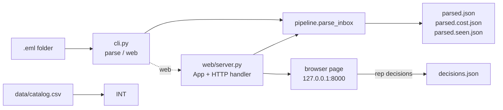
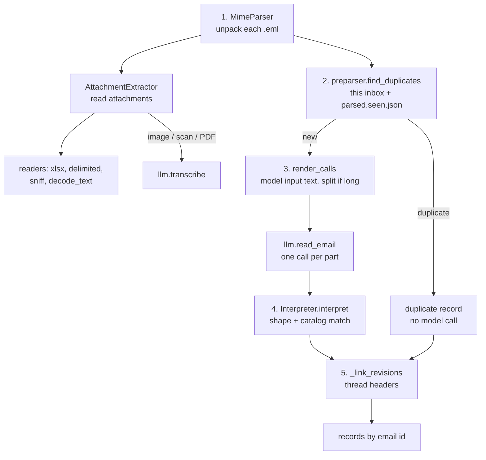
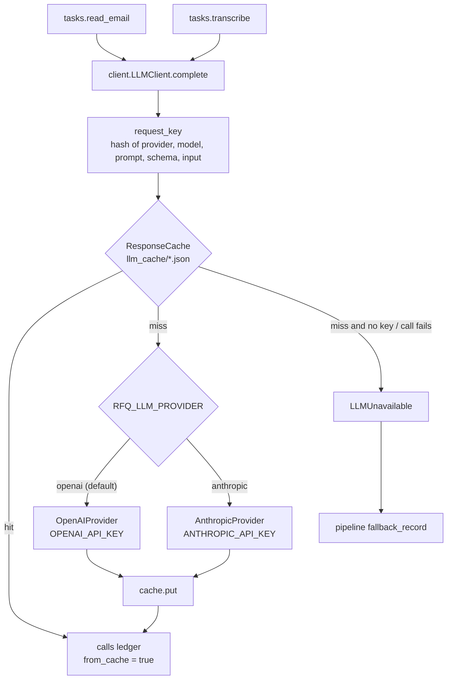

# Architecture: RFQ inbox parser

## Overview

## Pipeline (`rfq_parser/pipeline.py`)

Failure rules:

- `_read_one` catches every exception. An email the model cannot read gets `fallback_record`: class `rfq`, `needs_review: true`. Exception: bounces and out-of-office mail become `auto_reply`.
- An email with no model answer is not written to `parsed.seen.json`, so its next delivery is read.

## LLM layer (`rfq_parser/llm/`)

- Model: `RFQ_LLM_MODEL`, default `gpt-6.1-terra` (OpenAI). Effort `low`, `store` off.
- Cost: `cost_usd` uses `PRICES` from both provider modules. `cost_report` builds `parsed.cost.json` from the ledger, including cached calls.

## Interpreter (`rfq_parser/interpreter/`)

- `Interpreter.interpret(answer)` shapes the record. Request classes are `rfq`, `rfq_revision`, `purchase_order`. A request with no lines is forced to `needs_review`.
- `match(description)` per line, code only:
  - `attributes.parse` reads product, size, spec, material, ends, extras from text.
  - Filters in order: size, spec, material, ends, feature. Each filter that removes every part returns `not_in_catalog` with the reason.
  - One part left: `matched`. Several: `ambiguous` with up to 12 candidates.
- Catalog: `catalog.load_catalog` reads `data/catalog.csv`.
- No line is ever dropped.

## Web app (`rfq_parser/web/`)

- `App` runs `parse_inbox` once at start and keeps `trace` (unpacked email, model input, model answer) plus attachment files in a temp folder.
- `ThreadingHTTPServer` on `127.0.0.1` only. Routes: `/api/inbox`, `/api/email/<id>`, `/api/catalog?q=`, `/file/<id>/<n>`, `POST /api/decision`.
- `decide` writes the rep's choice to `decisions.json`. System records are never changed.
- Web runs without `seen_file`, so it does not use cross-run duplicate memory.

## Files

| Path | Role |
|---|---|
| `rfq_parser/cli.py` | `parse` and `web` commands, writes outputs |
| `rfq_parser/pipeline.py` | the run: order of work, fallbacks, revision links, cost report |
| `rfq_parser/mime_parser.py` | `.eml` to structured email |
| `rfq_parser/attachments/` | attachment extraction and readers |
| `rfq_parser/preparser.py` | duplicate detection, body text, part preparse |
| `rfq_parser/render.py` | model input text, split into calls |
| `rfq_parser/llm/` | model client, providers, cache, tasks, prompts, schemas |
| `rfq_parser/interpreter/` | record shaping and catalog matching |
| `rfq_parser/web/` | local review app |
| `data/` | catalog, format checker, record contract (`data/README.md`) |
| `diagnostics/` | `run.py` checks, `long_pdf.py` live test |
| `rfq_parser/llm/llm_cache/` | saved model answers, enables no-key replay |

## Outputs

| File | Written by | Content |
|---|---|---|
| `parsed.json` | `cli.parse` | one record per email |
| `parsed.cost.json` | `cli.parse` | calls, tokens, dollars per email |
| `parsed.seen.json` | `pipeline._save_seen` | Message-ID memory across runs |
| `decisions.json` | `web.App.decide` | rep decisions per line |
